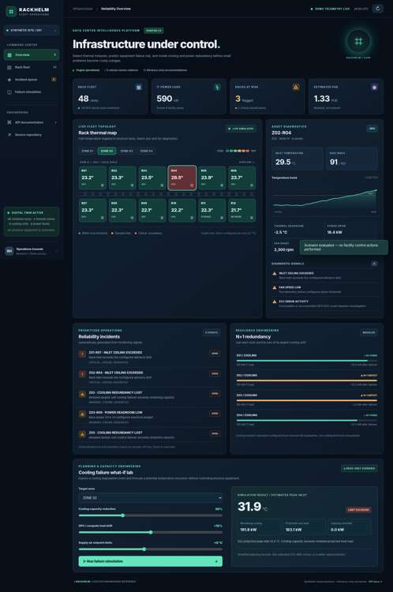
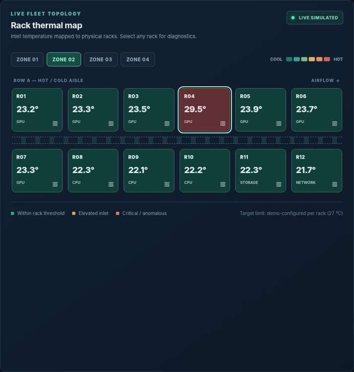
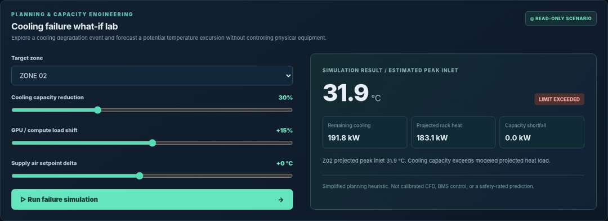
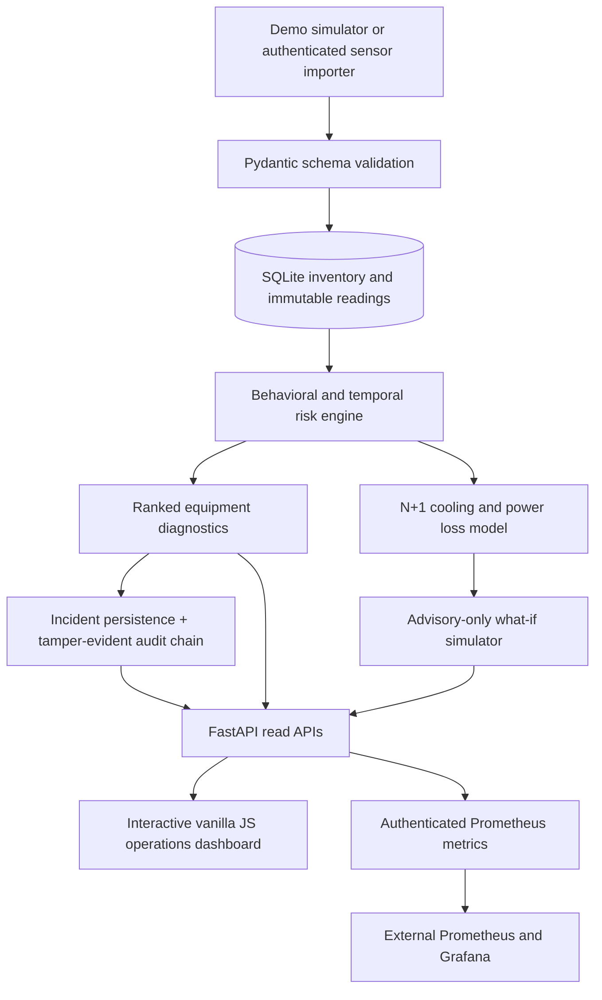

# RackHelm FleetOS

### Data Center Reliability Engineering · Thermal Early-Warning · GPU Fleet Monitoring · Cooling N+1 Resilience



**Engineering status:** runnable, automated-test-verified **data-center operations reference application**. The default deployment uses 100% synthetic telemetry. It does **not** operate physical cooling, electrical, or compute infrastructure, and it is not certified for safety-critical or unattended operational use.

## The real problem

Modern data centers need to combine three classes of signals that are often siloed: **rack inlet temperature and airflow**, **electrical supply and GPU compute demand**, and **cooling/redundancy capacity**. Operators who only see separate rack sensors can miss rising hotspots, failover shortfalls, or subtle deterioration until an incident is in progress.

[Uptime Institute's 2026 Annual Outage Analysis](https://ats.uptimeinstitute.com/about-ui/press-releases/uptime-announces-annual-outage-analysis-report-2026) highlights that power remains the leading cause of impactful outages and that high-density workloads and constrained power infrastructure are adding pressure. The engineering challenge is to spot problems early **and explain exactly what a technician should investigate**, not to hide risk behind a vague "AI" number.

**RackHelm FleetOS addresses that visibility gap** by combining timestamped equipment readings with explainable temporal detection and simple, transparent failure-capacity modeling. It produces prioritized **advisories** for operators; it never controls physical assets.

## What you can try immediately

- **48-rack facility digital twin:** four thermal zones, 28 GPU-dense racks, 8 cooling units, 8 A/B power feeds, and 1,728 synthetic sensor records on initial seed.
- **Dynamic thermal heatmap:** click any rack to see inlet temperature, historical trend, power, fan health, risk index and a time-to-configured-limit estimate.
- **Temporal anomaly detection:** robust median/MAD anomalies, 12-point temperature regression, stale sensors, fan decline, ECC error counts, electrical load and packet loss.
- **N+1 failure accounting:** independently models the largest cooling unit/feed being lost in a zone, with remaining headroom shown in kW. Cooling capacity is expressed as heat-removal equivalent, not electrical consumption.
- **Cooling-failure what-if:** adjustable 0–100% cooling capacity loss, -30% to +60% compute load, and supply setpoint changes. Returns a projected peak, deficit, and annotated limitations.
- **Persistent incident workflows:** open, acknowledge and resolve incidents using authorized operator API calls and an audit trail.
- **Real telemetry ingestion endpoint:** strict validation, bounded batches, UTC timestamps, atomic writes, exact replay idempotency and conflict rejection.
- **Prometheus monitoring and alert rules:** authenticated `/metrics` endpoint plus ready-to-adapt PromQL expressions.
- **Reproducible tests and containers:** Python API/unit tests, Docker Compose deployment, smoke checks and GitHub Actions.

### Screenshots captured from the actual frontend code

| Rack heatmap and diagnostics | Cooling-degradation simulation |
|---|---|
|  |  |

**Screenshot provenance:** The images were captured in headless Chromium running the real `index.html`, `styles.css` and `app.js` files against API response fixtures fetched from the running FastAPI application. Browser network access was restricted in the screenshot environment, so API calls were routed through locally captured backend responses. These are **real rendered UI captures**, not AI-generated mockups or screenshots of a live production data center. Reproduce them by starting the server, installing `.[screenshots]` and running `python scripts/capture_dashboard.py`.

## Quick start

**Option A — run with Python 3.11+**

```bash
# From the repository folder
python -m venv .venv
source .venv/bin/activate             # Windows: .venv\Scripts\activate
python -m pip install -e ".[dev]"
uvicorn rackhelm.api:app --host 127.0.0.1 --port 8000
```

Open **http://127.0.0.1:8000/** for the live dashboard, **http://127.0.0.1:8000/docs** for the API, and run `python scripts/smoke.py` in another terminal. The app seeds synthetic data automatically on first startup and advances a minute-level demo sample in the background while running.

**Option B — use Docker Compose**

```bash
docker compose up --build -d
curl http://127.0.0.1:8000/health
# Open http://127.0.0.1:8000/
```

The default Compose config binds only to `127.0.0.1`, drops Linux capabilities, runs as a nonroot user with a read-only root filesystem, and stores the SQLite database in a Docker volume. This does **not** substitute for secured, highly available infrastructure.

## API overview

| Method and path | Who may access | Returns / action |
|---|---|---|
| `GET /` | Demo mode | Responsive investigation dashboard |
| `GET /health` | Anyone | Process/database availability |
| `GET /api/v1/overview` | Demo / authenticated secure mode | Fleet risk summary, all racks and zones |
| `GET /api/v1/racks?zone=Z02` | Demo / authenticated secure mode | Filtered rack inventory |
| `GET /api/v1/racks/Z02-R04/history` | Demo / authenticated secure mode | Recent sensor series |
| `GET /api/v1/racks/Z02-R04/diagnostics` | Demo / authenticated secure mode | Signals, slope, remaining headroom, ETA |
| `GET /api/v1/incidents` | Demo / authenticated secure mode | Durable incident queue |
| `GET /api/v1/scenario?zone=Z02&cooling_drop_pct=50` | Demo / authenticated secure mode | Non-actuating engineering what-if |
| `POST /api/v1/telemetry/batch` | Operator API key | Atomic batch ingestion, duplicates safely handled |
| `POST /api/v1/incidents/{id}/status` | Operator API key | Acknowledge/resolve incident with audit event |
| `GET /api/v1/audit/verify` | Operator API key | Verify SHA-256 audit hash-chain integrity |
| `GET /metrics` | Operator API key | Prometheus-format numeric gauges |

### Ingest a sensor reading

For collector testing in the synthetic demo, explicitly opt into demo ingestion by setting `RACKHELM_ALLOW_DEMO_INGEST=1` **on the server before starting it**. This is disabled by default to prevent accidental exposure of customer data through public read endpoints; never use real customer/sensor records in demo mode. For actual controlled sensor testing, use `RACKHELM_MODE=secure` with an authenticated API gateway and a persistent database.

Set an **independent, randomly generated** `RACKHELM_OPERATOR_KEY` of at least 32 characters via a secret manager. The following sample uses placeholders and an automatically generated timestamp:

```bash
export RACKHELM_OPERATOR_KEY="<your-random-32-plus-character-secret>"
python - <<'PY'
import json, os
from datetime import datetime, timezone
from urllib.request import Request, urlopen
reading = {
    "rack_id": "Z02-R04",
    "observed_at": datetime.now(timezone.utc).isoformat(),
    "inlet_c": 27.4, "outlet_c": 39.2,
    "power_kw": 18.3, "gpu_util_pct": 84.0,
    "fan_rpm": 3100, "ecc_errors": 2, "packet_loss_pct": 0.02
}
request = Request(
    "http://127.0.0.1:8000/api/v1/telemetry/batch",
    data=json.dumps({"readings": [reading]}).encode(),
    headers={"Content-Type": "application/json", "X-API-Key": os.environ["RACKHELM_OPERATOR_KEY"]},
    method="POST",
)
print(json.load(urlopen(request, timeout=10)))
PY
```

Alternatively, import normalized records from a file with `python scripts/import_jsonl.py readings.jsonl --url http://127.0.0.1:8000`. The collector is a standard ingestion interface; **it is not an automatic, vendor-tested Redfish, SNMP, or BMS integration**.

## Architecture



**Implementation:** Python 3.11+, FastAPI, Pydantic v2, SQLite WAL, Python standard-library statistics, HTML/CSS/JavaScript, Prometheus exposition format, pytest, Docker, GitHub Actions. No paid APIs, remote LLM keys, or proprietary AI providers are necessary.

### Explainable math

**Time-respecting thermal slope (°C/minute).** For the most recent up to 12 valid timestamps, estimate the regression slope:

\[
\hat\beta = \frac{\sum_i (t_i-\overline{t})(T_i-\overline{T})}{\sum_i (t_i-\overline{t})^2}.
\]

If \(\hat\beta\) is positive and sufficiently large, estimate time to the configured inlet ceiling \(T_{max}\):

\[
\mathrm{ETA}_{min} = \frac{T_{max}-T_{current}}{\hat\beta},
\]

clipped to a bounded planning horizon; estimates are suppressed when a meaningful trend is absent. This is **not** a probability of failure.

**Robust outlier score.** Compare current temperature to the historical median using median absolute deviation (MAD), with a noise floor to prevent a constant sensor from causing division by zero:

\[
 z_{modified}=0.6745\frac{T_{current}-\mathrm{median}(T_{history})}{\max(\mathrm{MAD},0.28)}.
\]

**N+1 cooling failover.** Given cooling units' modeled heat-removal capacities \(C_i\) and current measured IT heat-equivalent load \(L\), estimate largest-unit-failure headroom:

\[
H_{cooling,N+1}=\left(\sum_i C_i-\max_i C_i\right)-L.
\]

The application also assesses power feeds separately using electrical kW. It does **not** incorrectly treat measured electrical consumption by the cooling system as IT heat-removal capacity.

**Composite risk index.** Rack risk aggregates bounded, documented rule weights for thermal headroom, warming rate, robust anomalies, load, fan RPM, ECC, packet loss, cooling redundancy and freshness; clamp at 100. Scores are engineering **prioritization indices**—not supervised ML probabilities and not safety certification.

**PUE:** an estimated illustrative power usage effectiveness based on a synthetic COP=3.5 and assumed overhead. **This is not a certified PUE measurement**; actual PUE requires site-metered facility and IT energy boundaries.

## Operational security and trust boundaries

- Demo endpoints expose **synthetic, non-identifying** inventory and no equipment controls.
- Writes and `/metrics` require a private, sufficiently long, constant-time-compared API key. Demo-mode ingestion is additionally **disabled by default**.
- In `RACKHELM_MODE=secure`, read endpoints require the same operator credential and the dashboard is not served.
- Secure mode refuses to start without the operator key and a non-temporary database location; unexpected mode names fail closed.
- Telemetry is schema-checked, UTC normalized, freshness bounded and limited to 200 samples per request.
- SQLite uses a single atomic `BEGIN IMMEDIATE` transaction for batch validation/write; identical replays are idempotent and conflicting duplicates abort the entire batch.
- Incident state changes are recorded in a SHA-256 **tamper-evident** chained log with an integrity verification endpoint.
- Secure response headers (CSP, HSTS, COOP/CORP, Permissions-Policy, no-store, noindex), no untrusted HTML injection in dashboard JavaScript, safe Prometheus asset labels.
- Request bodies are hard-capped (`RACKHELM_MAX_BODY_BYTES`) and chunked write bodies are refused, so a client cannot stream an unbounded payload.
- Per-address rate limiting (`RACKHELM_RATE_LIMIT_PER_MINUTE`, default 600/min) with `/health` exempt for liveness probes.
- Cross-origin browser reads are disabled by design: no CORS headers are issued.
- CI pins every GitHub Action to a commit SHA and runs `pip-audit`, gitleaks secret scanning, CodeQL and weekly Dependabot updates.
- Docker runs nonroot with a read-only root filesystem and all Linux capabilities dropped.

**Limits:** local SQLite is not high-availability storage, a hash chain without off-host anchoring is not immutable evidence, API keys are not enterprise SSO/OIDC, public demo endpoints must never contain real customer telemetry, and dashboards are not certified control systems. See [Security and production gaps](docs/SECURITY.md).

## Engineering verification

```bash
python -m pip install -e ".[dev]"
pytest -q
ruff check src tests scripts
python scripts/smoke.py                 # server must be running
python -m rackhelm.cli audit           # or: rackhelm audit after install
```

GitHub Actions tests Python, lint, wheel build and Docker smoke against multiple endpoints. Tests include bounded data validation, atomic ingestion conflicts and rollback, rack thermal regression, N+1 failover, read/write authentication, incident status transitions, tampered audit chain, and simulation behavior.

## Repo layout

```text
src/rackhelm/
  api.py                FastAPI routes, guarded writes, security response headers
  analytics.py          Thermal trend, MAD, risk fusion, N+1, scenario forecasts
  demo.py               Seeded synthetic facility with GPU hotspots
  observability.py      Prometheus gauges with bounded asset labels
  schemas.py            Strict Pydantic sensor and inventory validation
  store.py              SQLite time-series, event incidents and audit chain
  service.py            Risk enrichment and action recommendations
  web/                  Responsive dashboard UI + live API calls
scripts/
  import_jsonl.py       Operator-authenticated JSONL ingestion utility
  smoke.py              Live REST/system smoke test
tests/                   Tests of API, sensor models, risk, storage, metrics
.github/workflows/ci.yml  Tests, lint, dependency audit, secret scan, container smoke
.github/workflows/codeql.yml  Static analysis
Dockerfile / compose.yaml / .env.example
LICENSE / THIRD-PARTY-NOTICES.md  License terms and dependency attributions
docs/                    Architecture, security, operating guide, real screenshots
```

## What makes this relevant to data-center jobs?

RackHelm demonstrates the kinds of decisions fleet reliability and infrastructure engineers make: identifying rack hotspots, tracking power headroom, understanding GPU-intensive rack loads, investigating environmental sensors, checking redundancy assumptions, working with incident queues, performing root-cause triage, and communicating prioritized findings to on-call teams.

This is an **original implemented portfolio project**, not a claim of real data-center employment, certification, or measured performance. Site operators must calibrate thresholds, validate sensor provenance, and obtain approval before making changes to cooling or production workloads.

**Next-phase engineering:** PostgreSQL/TimescaleDB, SNMP/Redfish integrations, Grafana dashboards, real Kubernetes/GPU node inventory, OIDC/RBAC, site-calibrated model evaluation, high-availability message transport, distributed tracing, independent security review and disaster recovery tests.

---

Built for **hardware reliability, infrastructure operations and applied systems engineering**. See [Architecture](docs/ARCHITECTURE.md) · [Operations runbook](docs/RUNBOOK.md) · [Security](docs/SECURITY.md) · [Validation limits](docs/VALIDATION.md).

## Prometheus and Grafana references

`deploy/grafana-dashboard.json` is an importable Grafana dashboard template for rack temperatures, power, composite risk and N+1 margins. `deploy/prometheus.rules.yml` contains PromQL alerts. Neither Grafana nor Prometheus is provisioned in the standalone application; connect them to your private monitoring stack after configuring authenticated scraping. The `/metrics` endpoint is **not publicly accessible**.

## GitHub publishing

To publish this complete download as a new repository, see [GITHUB_PUBLISH.md](docs/GITHUB_PUBLISH.md). The project archive itself is not an automatic GitHub commit.

## Real data-center server connectivity — Redfish

RackHelm now includes a **read-only Redfish connector** that can collect inlet temperature, outlet temperature, fan RPM and consumed power from explicitly configured HTTPS BMC endpoints and send the resulting readings to the authenticated RackHelm telemetry API. The connector uses read-only credentials, TLS verification, bounded responses and no BMC control commands. See the [Redfish setup and security guide](docs/REDFISH_CONNECTOR.md) and [example inventory](config/redfish.example.json).

**Integration status:** implemented and tested against fixtures; **not yet tested on physical servers**. A real deployment requires approved management-network access, vendor-specific sensor mapping, and operational security review. Optional GPU/network metrics may be unavailable and are not claimed as measured.

---

## License and attribution

Released under the [MIT License](LICENSE). [THIRD-PARTY-NOTICES.md](THIRD-PARTY-NOTICES.md) lists every runtime dependency with its own license; all of them are permissive and require no source disclosure from you.

The MIT text includes the standard "as is, without warranty of any kind" clause, which is the **only** liability limitation this repository provides. It does not certify the software as fit for any purpose, does not make a deployment compliant with law or industry regulation, and is not legal advice. Anything used in a real facility still needs its own engineering, safety, privacy and contractual review. Security findings are reported through [docs/SECURITY.md](docs/SECURITY.md).